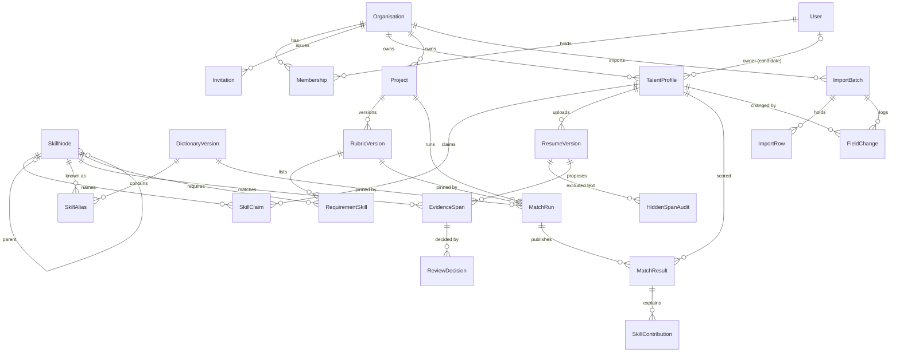

# Data model

Every row holding personal data belongs to exactly one organisation. Organisation comes from the
user's verified membership, never from request data. Skills and dictionaries are global reference
data and hold no personal data.

## Constraints that matter

| Model | Constraint | Enforced by |
| --- | --- | --- |
| Organisation | slug unique | DB |
| Membership | unique (user, organisation) | DB |
| TalentProfile | unique (organisation, source_system, external_id) when external_id is set; allocation 0 to 100 | DB |
| TalentProfile | one profile per (organisation, owner) when owner is set | DB |
| SkillClaim | unique (profile, skill) | DB |
| SkillAlias | unique (text, dictionary_version) | DB |
| ResumeVersion | unique (profile, version); private object key | DB |
| RubricVersion | unique (project, version) | DB |
| RequirementSkill | unique (rubric, skill); weight > 0 | DB |
| Approved rubric | immutable: `save`, `delete`, `.update`, `.bulk_*` raise; a PostgreSQL trigger refuses raw SQL too | ORM + DB |
| MatchRun | unique (organisation, idempotency_key) | DB |
| MatchResult | unique (run, profile) | DB |
| Tenant links | a run and its profile, a rubric and its project share one organisation: `save()` checks, and bulk writes have no code path | ORM |

## Decisions the requirements left to this document

| Question | Answer |
| --- | --- |
| Role home URLs | Candidate `/me/`; Recruiter `/projects/`; Delivery Manager `/bench/`; Admin `/dashboard/` |
| Refused status for a wrong role | 403 with nothing written. Cross-organisation lookups stay 404 |
| How a Candidate joins | A staff-issued, expiring, single-use `Invitation` redeemed at `/join/`. Tokens are stored hashed |
| More than one membership | The oldest active membership is used; there is no organisation switcher in v1 |
| Job-result route | `GET /api/resumes/{id}/` reports the scan job's state. There is no separate job route |
| Closed project | Keeps its runs and exports readable. Refuses new runs, rubric edits and edits to the project |
| Metadata findings | `HiddenSpanAudit` row with `page` and `bbox` empty and `field_name` set |
| Tenant link guard | `save()` raises across organisations; `.update()` and bulk paths for those links do not exist in code |
| Rubric immutability | Guarded queryset plus a PostgreSQL trigger (migration `projects.0002`). The API answers 409 |
| Verified | `ReviewDecision` with outcome `VERIFIED`, method `TEST` or `INTERVIEW`, and a reason. Staff only |
| Unmet with no span | `ReviewDecision` with outcome `UNMET`, a skill and a reason, and no span |
| Reason for a score change | `MatchResult.change_reasons`: list of `{decision_id, skill, old_e, new_e, reason}` |
| Data owner for imports | Admin role only |
